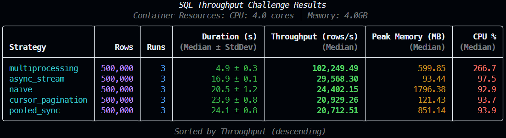
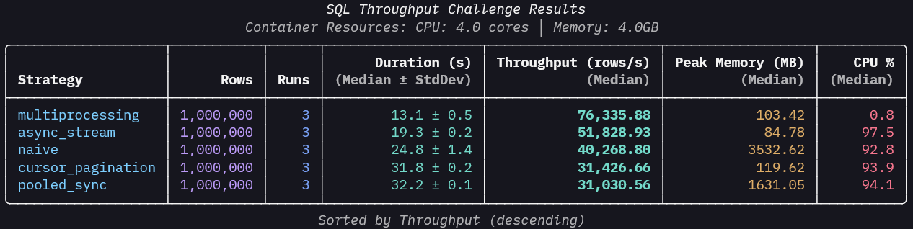

# SQL Throughput Challenge

> **A reproducible benchmark lab for PostgreSQL bulk-read architecture in Python.**


It compares five execution strategies under fixed CPU/RAM constraints and reports throughput, peak memory, and CPU behavior across 100K, 500K, and 1M row workloads.

| Strategy | One-liner |
| --- | --- |
| **Naive** | `fetchall()` baseline to expose Python-side memory saturation. |
| **Cursor Pagination** | Server-side cursor streaming to enforce near-constant client memory. |
| **Pooled Sync** | `psycopg_pool` checkout model for batched sync reads under connection reuse. |
| **Async Stream** | `asyncpg` cursor fan-out with bounded concurrency for non-blocking I/O pipelines. |
| **Multiprocessing** | Multi-process ID-partitioned fan-out to bypass the GIL and scale row decode throughput. |

## Reproducible benchmark

Primary command (containerized limits via Compose):

```bash
make benchmark ROWS=100000 RUNS=3
```

What it does:

1. Builds the benchmark image and starts Postgres with the Compose resource caps in `docker-compose.benchmark.yml`.
2. Seeds `ROWS` deterministic records.
3. Runs every strategy `RUNS` times (aggregates duration, throughput, rows, CPU, and RSS statistics from `ok` runs, falling back to `partial` or all runs).
4. Prints a status-aware results table to the console (including completed results if interrupted).
5. Writes `results/latest.json` and a timestamped `results/run-<UTC>.json` artifact with per-run metrics, `status` (`ok` / `partial` / `failed`), and a top-level `summary` (status counts, error count, and run completion metadata).

CLI exit status: `0` when all runs are `ok`, `1` when any run is `partial` or `failed`, and `130` when interrupted (Ctrl-C).

Same harness without Compose (local Postgres + Poetry):

```bash
poetry run python scripts/generate_data.py --rows 10000
poetry run python -m src.main run --strategy all --rows 10000 --runs 3
```

Detailed methodology: [docs/methodology.md](docs/methodology.md)

## Measured results

### Local verification (this environment)

Command:

```bash
poetry run python scripts/generate_data.py --rows 10000
poetry run python -m src.main run --strategy all --rows 10000 --runs 3
```

No locally measured figures are published in this PR; to produce current numbers run the reproducible command and read `results/latest.json` (and commit the generated `results/run-<UTC>.json` next to any figure you publish).

### Historical containerized evidence (100K / 500K / 1M)

The following medians come from checked-in artifacts under Compose resource limits (`benchmark` 4 CPU / 4 GB, Postgres 2 CPU / 2 GB), 3 runs per strategy. Treat them as historical machine-specific evidence, not guarantees for a fresh host:

| Strategy | 100K rows/s | 500K rows/s | 1M rows/s | 1M peak RSS (MB) |
| --- | ---: | ---: | ---: | ---: |
| **Multiprocessing** | 39,370 | 102,249 | 124,378 | 777 |
| **Async Stream** | 28,089 | 29,568 | 28,901 | 101 |
| **Naive** | 25,510 | 24,402 | 23,359 | 3,537 |
| **Pooled Sync** | 20,450 | 20,713 | 20,576 | 1,644 |
| **Cursor Pagination** | 21,413 | 20,929 | 19,520 | 126 |

Sources: `results/run-20260207T002833Z.json`, `results/run-20260207T003446Z.json`, `results/run-20260207T003640Z.json`.

Re-generate comparable numbers with:

```bash
make benchmark ROWS=100000 RUNS=3
make benchmark ROWS=500000 RUNS=3
make benchmark ROWS=1000000 RUNS=3
```

### Visual Evidence





## Problem Statement

In Python backend development, choosing between `sync`, `async`, or `multiprocessing` for bulk-read operations is often driven by "vibe" or trends rather than empirical data. When engineering teams can’t quantify where a strategy fails, the result is:

- **Unpredictable OOM Incidents:** Hidden memory spikes in ETL jobs that crash production containers.
- **SLA Breaches:** Latency degradation that only appears under specific "workload shapes."
- **Wasted Cloud Spend:** Over-provisioning resources because the execution bottleneck (CPU vs. I/O) isn't truly understood.

**This project replaces anecdote with evidence.** It provides a standardized framework to profile and justify architectural choices based on measured memory RSS, throughput, and latency across diverse operating envelopes.


## Technical Decisions

The strategy portfolio intentionally spans a full decision surface: baseline (`naive`), memory-safe serial stream (`cursor_pagination`), pool-managed sync (`pooled_sync`), event-loop concurrency (`async_stream`), and CPU-parallel fan-out (`multiprocessing`). This was selected to separate bottlenecks rather than mask them. For example, cursor streaming improves consistency and memory predictability by holding a transaction and consuming deterministic batches, but that same choice trades off latency under high demand because work remains serialized on one Python process. In contrast, multiprocessing improves latency and raw throughput by parallelizing decode work across processes, but pays for that gain in higher aggregate RSS and orchestration overhead. The design goal is not to crown a universal winner; it is to map which architecture is dominant for each workload and operational constraint.

The project is deliberately SQL-first instead of adding NoSQL paths because the target problem is relational analytical reads with ordering guarantees and transactional semantics. SQL provides deterministic row selection (`ORDER BY id`, bounded `LIMIT`, transactional cursor scope) that makes cross-run comparisons valid, while equivalent NoSQL scans would introduce different consistency and index trade spaces that dilute the benchmark question. Within SQL, driver choices are similarly intentional: `asyncpg` is used for async streaming due to protocol efficiency, while `psycopg3` + `psycopg_pool` covers synchronous and pooled control paths.

Python/backend best practices are built into execution quality: strict static typing (`mypy` with `disallow_untyped_defs`), validated settings via Pydantic, safe process start mode (`spawn`) for cross-platform isolation, explicit timeout controls (`DB_STATEMENT_TIMEOUT_MS`), run-level failure policies (tolerant vs strict), and profiler-based peak RSS/CPU measurement with background sampling to capture transient spikes.

## Known limits (engineering trade-offs)

- **Localhost / container network:** Host-local or Compose networking minimizes WAN latency, so results emphasize driver/decode cost over wide-area I/O.
- **Read-only single table:** No write contention, locking, or multi-table `JOIN` cost is measured.
- **Multiprocessing ID prefetch:** The multiprocessing path still materializes the selected ID list in the parent before chunk fan-out; async concurrent mode windows large ID sets, but multiprocessing does not yet.
- **Naive all-or-nothing:** `naive` uses `fetchall()` and is therefore all-or-nothing; any failure yields no partial rows.
- **Interrupted in-flight runs:** When a run is interrupted (Ctrl-C), rows read so far by the in-flight run are unknown and recorded as 0 (`failed` with `extra.interrupted=true`).
- **Partial failure semantics:** Worker/batch errors are counted into `status` + `summary.error_count` and fail the process exit code, but tolerant mode continues remaining strategies/runs by design.
- **Host variance:** Throughput and RSS depend on CPU count, memory pressure, and Postgres tuning; compare runs only under the same command and resource envelope.
- **Statistical depth:** Default publishable comparisons should use several runs (`RUNS=3` minimum; more is better) plus optional `--warmup`.
